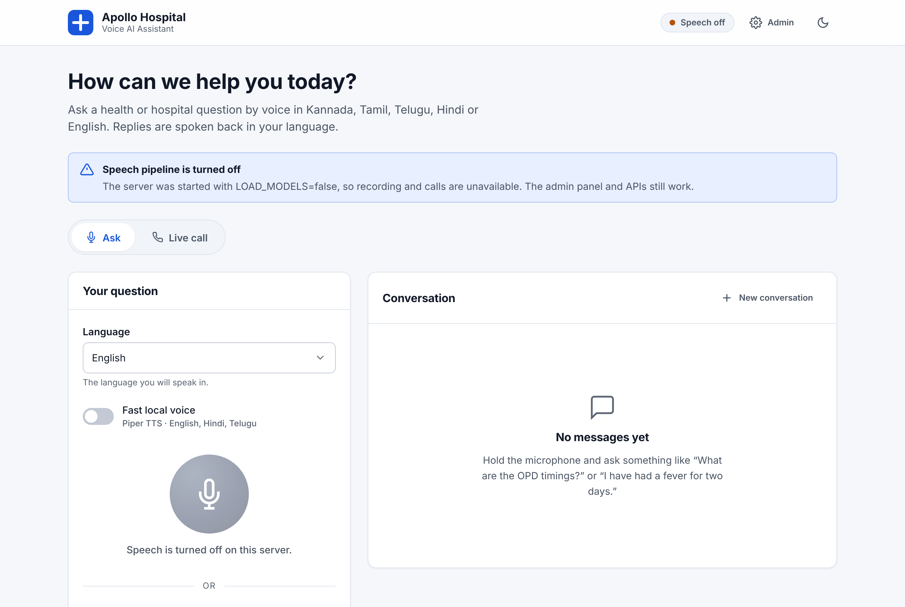
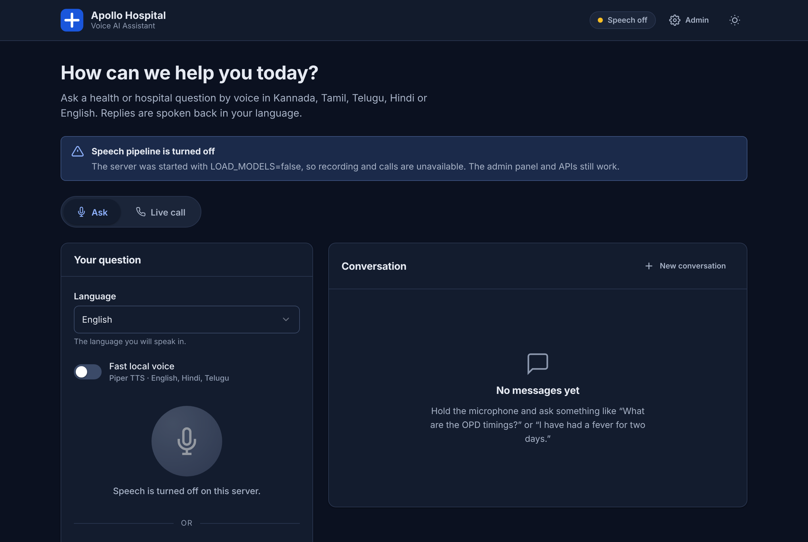
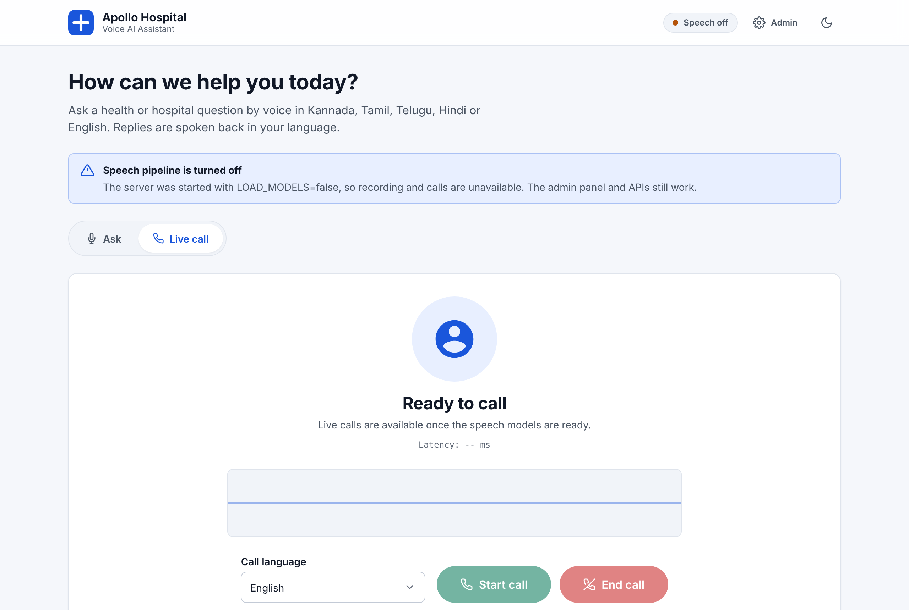
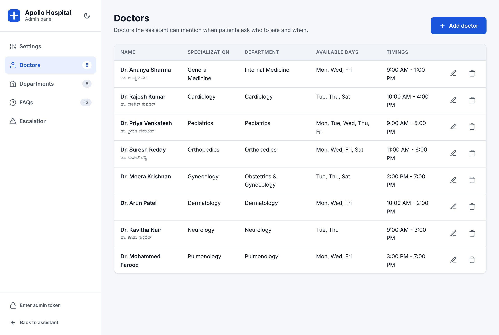
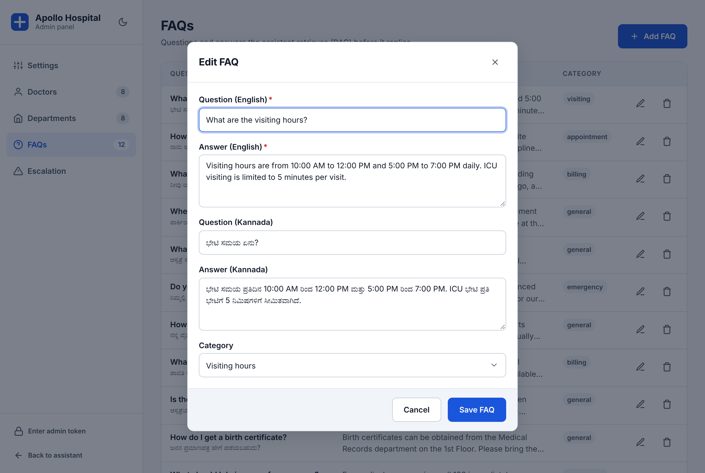
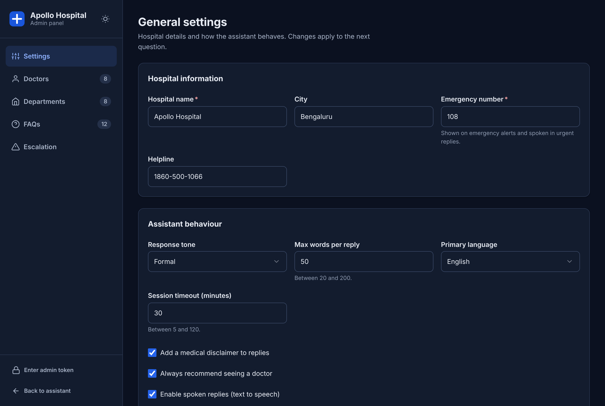
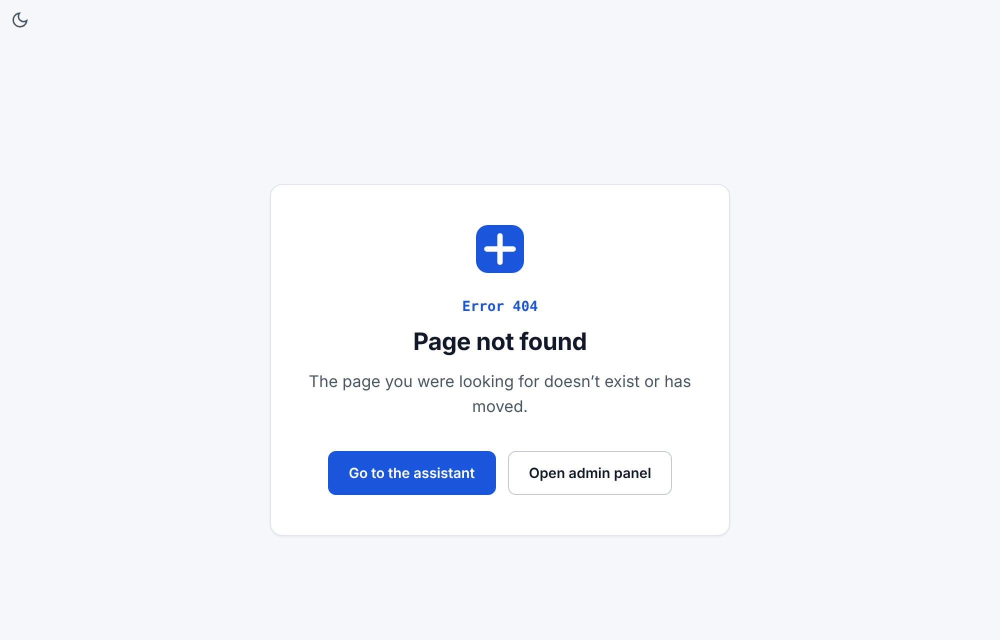
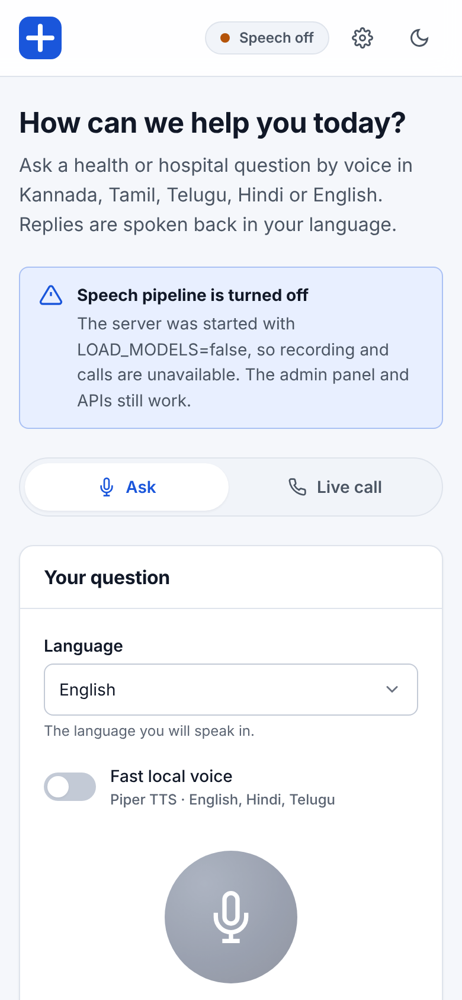
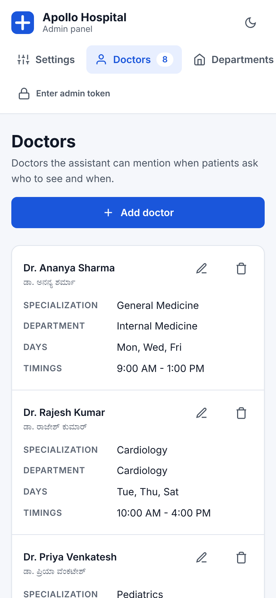
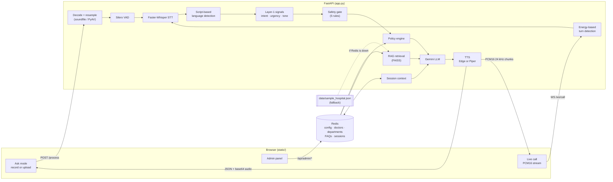

# Apollo Hospital Voice AI Assistant


**A real-time voice assistant that answers hospital patients in Kannada, Tamil, Telugu, Hindi or English, and flags emergencies before it answers.**



---

## Contents

- [Overview](#overview)
- [Screenshots](#screenshots)
- [Features](#features)
- [Tech stack](#tech-stack)
- [Architecture](#architecture)
- [Project structure](#project-structure)
- [Getting started](#getting-started)
- [Configuration](#configuration)
- [Running the app](#running-the-app)
- [Usage](#usage)
- [API reference](#api-reference)
- [Scripts and commands](#scripts-and-commands)
- [Testing](#testing)
- [Linting and formatting](#linting-and-formatting)
- [Deployment](#deployment)
- [Troubleshooting and FAQ](#troubleshooting-and-faq)
- [Known limitations](#known-limitations)
- [Roadmap ideas](#roadmap-ideas)
- [Contributing](#contributing)
- [License](#license)

---

## Overview

Hospital helplines in India get calls in many languages. A lot of them are routine (*"What are
the OPD timings?"*, *"Which doctor sees children on Saturday?"*), and a few are emergencies
that must not wait in a queue. This project is a voice front-desk for those calls:

1. The caller speaks in their own language.
2. The audio is checked for speech, transcribed and tagged with its language.
3. Fast keyword rules work out the **intent**, **urgency** and **tone**, and a **safety gate**
   decides whether to escalate (chest pain, breathing trouble, admin-defined keywords, and so on).
4. The hospital's own FAQs, doctors and departments are retrieved (RAG) and passed to an LLM
   together with the conversation so far.
5. The reply is spoken back in the caller's language and script.

Hospital staff change what the assistant knows (doctors, departments, FAQs, escalation
keywords, tone, disclaimer) from an **admin panel**, with no code changes.

**Who it's for:** hackathon judges and developers exploring voice AI for Indian languages, and
hospital IT teams who want a starting point for a multilingual voice front-desk.

> [!IMPORTANT]
> This is a demo, not a medical device. Intent, urgency and escalation rules are simple keyword
> heuristics and are no substitute for clinical triage.

---

## Screenshots

All screenshots are from the app running locally with the bundled sample data
(`data/sample_hospital.json`). They were taken with `LOAD_MODELS=false`, so the status pill reads
**Speech off** and the microphone is disabled. With models loaded, the same screens show the
transcript, the spoken reply and per-stage latencies.

| Ask mode, dark theme | Live call |
| --- | --- |
|  |  |

| Admin: doctors | Admin: editing an FAQ |
| --- | --- |
|  |  |

| Admin: settings, dark theme | Not-found page |
| --- | --- |
|  |  |

| Phone: assistant | Phone: admin (tables become cards) |
| --- | --- |
|  |  |

---

## Features

### For callers

- **Two modes**
  - **Ask:** hold the microphone button (mouse, touch, or hold <kbd>Space</kbd> on the
    keyboard) or upload an audio file. The page shows the transcript, the reply with an audio
    player, the detected signals and the latency of each pipeline stage.
  - **Live call:** a WebSocket voice call. The server detects the end of a turn from silence and
    streams the reply back sentence by sentence as PCM audio.
- **Five languages:** Kannada, Tamil, Telugu, Hindi and English, for speech-to-text, signals,
  replies and text-to-speech.
- **Emergency alert:** when the safety gate escalates, the page shows the reason and a
  tap-to-call button for the emergency number set in the admin panel.
- **Conversation memory:** the patient's name, age, symptoms, duration and requested doctor are
  extracted from each turn and given back to the LLM as context. Reloading the page restores the
  conversation; **New conversation** starts over.

### Under the hood

- **Layer-1 signals before the LLM:** keyword intent (medical query, appointment, billing/admin,
  greeting), urgency, stress and tone in all five languages, with word-boundary matching for
  Latin script.
- **Safety gate with five rules:** critical symptoms and admin-defined keywords; chest or
  breathing complaints; weak-confidence medical queries; several urgency cues; and the same
  question repeated within a session.
- **Policy engine:** hospital name, tone, word limit, disclaimer, emergency number and helpline
  are injected into every LLM prompt from the admin config.
- **RAG over hospital data:** FAQs, doctors and departments are embedded with a multilingual
  sentence-transformer and searched with FAISS. The index is rebuilt when admin data changes.
- **Graceful degradation:** runs without Redis (in-memory sessions and bundled sample data),
  without an LLM key (fixed fallback reply), and with `LOAD_MODELS=false` (admin and APIs only).
  Models load in a background thread, so the UI is usable at once and reports progress.

### Admin panel (`/admin`)

- Edit hospital details and assistant behaviour, doctors, departments, FAQs and escalation
  keywords.
- Optional bearer-token protection (`ADMIN_TOKEN`) for every write. The panel asks for the token
  in a dialog the first time a change is rejected and keeps it only for the browser tab.
- Read-only banner when Redis is not connected, so staff know why saving is disabled.

### Interface

- One design system shared by every page: spacing and type scales, colour tokens with WCAG AA
  contrast, and consistent buttons, inputs, cards, badges, toasts and dialogs.
- **Light and dark themes:** follows the OS setting, with a toggle in the header that is
  remembered per browser.
- **Responsive** from 375 px phones to wide desktops. Admin tables turn into labelled cards on
  small screens, and touch targets are at least 40 px.
- **Accessible:** semantic landmarks and headings, a skip link, ARIA tabs with arrow-key
  navigation, visible focus rings, labelled controls, native `<dialog>` modals (focus trap and
  <kbd>Esc</kbd>), live regions for status and errors, inline form validation, and
  `prefers-reduced-motion` support.
- **Clear states everywhere:** loading skeletons, empty states with a call to action, error
  states with retry, busy buttons while saving, and friendly messages (for example *"No speech
  was detected. Speak a little louder or closer to the microphone."*).
- A styled 404 page, an SVG favicon, page titles, meta descriptions and Open Graph tags.

---

## Tech stack

| Layer | Technology |
| --- | --- |
| API server | [FastAPI](https://fastapi.tiangolo.com/), [Uvicorn](https://www.uvicorn.org/), WebSockets |
| Voice activity detection | [Silero VAD](https://github.com/snakers4/silero-vad) (`silero-vad` package, PyTorch) |
| Speech-to-text | [Faster-Whisper](https://github.com/SYSTRAN/faster-whisper) (`large-v3` by default; CUDA float16 or CPU int8) |
| Audio decoding | `soundfile`, with PyAV as a fallback for WebM/Opus and MP3; `librosa` for resampling |
| LLM | Google Gemini via [`google-genai`](https://pypi.org/project/google-genai/) (`gemini-2.0-flash` by default) |
| Text-to-speech | Microsoft Edge neural voices via [`edge-tts`](https://github.com/rany2/edge-tts); optional local [Piper](https://github.com/rhasspy/piper) voices for Hindi and Telugu |
| Retrieval (RAG) | [sentence-transformers](https://www.sbert.net/) `paraphrase-multilingual-MiniLM-L12-v2` + [FAISS](https://github.com/facebookresearch/faiss) |
| Storage | [Redis](https://redis.io/) for config, doctors, departments, FAQs and sessions (with TTL); optional |
| Frontend | Vanilla HTML, CSS and JavaScript; MediaRecorder and Web Audio APIs; no build step |
| Tooling | pytest, fakeredis, Ruff |

Edge voices used: `kn-IN-GaganNeural`, `ta-IN-PallaviNeural`, `te-IN-ShrutiNeural`,
`hi-IN-SwaraNeural`, `en-IN-NeerjaNeural`. Piper voices: `hi_IN-rohan-medium`,
`te_IN-maya-medium`.

---

## Architecture



### Request lifecycle (Ask mode)

1. The browser records WebM/Opus (or OGG/MP4, depending on the browser) and posts it to
   `/process` with the chosen language, TTS provider and session ID.
2. The server decodes and resamples to 16 kHz mono, runs Silero VAD, and returns early with
   *"No speech detected"* if there is none.
3. Faster-Whisper transcribes. The language comes from the user's choice or from the Unicode
   script of the transcript.
4. Layer-1 signals, the safety gate and the policy engine run in well under a millisecond each.
5. Session context and the top RAG matches are added to the prompt, and Gemini generates the
   reply (or a fixed fallback without an API key).
6. Edge TTS (or Piper) speaks the reply. The response carries the transcript, reply, base64
   audio, escalation decision, signals and per-stage latencies.

Blocking model calls run in FastAPI's threadpool, so the event loop stays responsive.

### Modules

| Module | Responsibility |
| --- | --- |
| `app.py` | FastAPI app: routes, admin auth, 404 page, pipeline orchestration, WebSocket call loop |
| `voice_ai/settings.py` | Environment-based configuration (reads `.env`) |
| `voice_ai/signals.py` | Pure logic: language detection, Layer-1 signals, safety gate, policy, prompts, sentence splitting |
| `voice_ai/speech.py` | Model loading and VAD / STT / LLM / TTS wrappers, audio decoding and resampling |
| `voice_ai/conversation.py` | Session store (Redis or memory) and context extraction (name, age, symptoms, duration, doctor) |
| `voice_ai/embeddings.py` | Embedding model, FAISS index, RAG retrieval and prompt formatting |
| `voice_ai/redis_store.py` | Redis CRUD for config, doctors, departments, FAQs and sessions, with offline fallback |
| `voice_ai/streaming.py` | Live-call turn detection (energy threshold + 0.5 s silence) |

---

## Project structure

```text
.
├── app.py                       # FastAPI app: routes, auth, pipeline, WebSocket call loop
├── voice_ai/                    # Core Python package
│   ├── settings.py              #   env/.env configuration
│   ├── signals.py               #   language detection, signals, safety gate, policy, prompts
│   ├── speech.py                #   VAD / STT / LLM / TTS wrappers and audio decoding
│   ├── conversation.py          #   sessions and context extraction
│   ├── embeddings.py            #   sentence-transformer embeddings + FAISS RAG
│   ├── redis_store.py           #   Redis persistence with graceful fallback
│   └── streaming.py             #   live-call turn detection
├── static/                      # Frontend, served at /static (no build step)
│   ├── base.css                 #   design system: tokens, light/dark themes, components
│   ├── ui.js                    #   theme toggle and toast helper (shared)
│   ├── index.html · styles.css · app.js     # voice assistant (/)
│   ├── admin.html · admin.css · admin.js    # admin panel (/admin)
│   ├── 404.html                 #   not-found page
│   └── favicon.svg
├── data/sample_hospital.json    # Demo config, 8 doctors, 8 departments, 12 FAQs
├── scripts/
│   ├── seed_data.py             # Load the sample data into Redis
│   └── download_piper_voices.sh # Fetch the optional Piper voices (~63 MB each)
├── tests/                       # pytest suite (API, signals, sessions, Redis, streaming, audio)
├── experiments/                 # Research notebook and TTS benchmarks (not used by the app)
├── docs/screenshots/            # Screenshots used in this README
├── piper_voices/                # Downloaded Piper voices (git-ignored)
├── requirements.txt             # Runtime dependencies
├── requirements-dev.txt         # Lightweight test and lint dependencies
├── pyproject.toml               # Project metadata, Ruff and pytest configuration
├── .env.example                 # Documented configuration template
└── run.sh                       # One-command local launcher (macOS/Linux)
```

---

## Getting started

### Prerequisites

| Requirement | Notes |
| --- | --- |
| Python 3.10+ | Developed and tested on 3.13 |
| `pip` and `venv` | Bundled with Python |
| A Gemini API key | Free from [Google AI Studio](https://aistudio.google.com/app/apikey). Optional: without it, replies are a fixed fallback message |
| Redis 6+ | Optional. Needed to edit admin data and to persist sessions |
| NVIDIA GPU with CUDA | Optional. Recommended for `large-v3`. On CPU, use `WHISPER_MODEL=small` or `medium` |
| Internet access | First run downloads Whisper and the embedding model from Hugging Face. Gemini and Edge TTS are online services |
| A modern browser | Microphone access works only on `localhost` or HTTPS |

### Installation

```bash
# 1. Clone
git clone https://github.com/jeevithg090/Demo-Day-New.git
cd Demo-Day-New

# 2. Create and activate a virtual environment
python3 -m venv venv
source venv/bin/activate            # Windows: venv\Scripts\activate

# 3. Install dependencies (PyTorch, Faster-Whisper, etc.; a few GB)
pip install -r requirements.txt

# 4. Configure
cp .env.example .env                # then set GEMINI_API_KEY, ADMIN_TOKEN, WHISPER_MODEL

# 5. Optional: Redis with sample hospital data
redis-server --daemonize yes        # or: docker run -d -p 6379:6379 redis:7
python scripts/seed_data.py --clear

# 6. Optional: local Piper voices for Hindi and Telugu
./scripts/download_piper_voices.sh
```

On macOS and Linux, `./run.sh` does steps 2 to 5 for you (it creates `venv/`, installs
dependencies, starts and seeds Redis if `redis-server` is installed) and then starts the server
with auto-reload.

---

## Configuration

All settings are environment variables. They can also go in a `.env` file in the repository
root; real environment variables take precedence. See [`.env.example`](.env.example).

| Variable | Required | Default | Description |
| --- | --- | --- | --- |
| `GEMINI_API_KEY` | Recommended | *(empty)* | Google Gemini API key. Without it, every reply is a fixed "please call the helpline" message, though STT, signals and escalation still run. |
| `GEMINI_MODEL` | No | `gemini-2.0-flash` | Gemini model name. |
| `WHISPER_MODEL` | No | `large-v3` | Faster-Whisper size: `tiny`, `base`, `small`, `medium`, `large-v3`. Use `small` or `medium` on CPU. |
| `REDIS_HOST` | No | `localhost` | Redis host. |
| `REDIS_PORT` | No | `6379` | Redis port. |
| `REDIS_DB` | No | `0` | Redis database number. |
| `ADMIN_TOKEN` | **Yes in production** | *(empty)* | Bearer token required for admin write endpoints. Empty means writes are open, which is fine only for local development. |
| `CORS_ORIGINS` | No | *(empty)* | Comma-separated allowed origins. Empty means same-origin only (the bundled UI needs nothing else). |
| `MAX_UPLOAD_MB` | No | `10` | Maximum `/process` upload size in MB. The UI reads it from `/health` and checks files before uploading. |
| `PIPER_VOICE_DIR` | No | `./piper_voices` | Directory containing Piper `.onnx` voices. |
| `LOAD_MODELS` | No | `true` | `false` starts only the web UI, admin and session APIs, without speech models. Useful for admin-only hosting, UI work and CI. |
| `HF_TOKEN` | No | *(empty)* | Only for gated models used in `experiments/`. The app does not need it. |

Hospital-level settings (name, city, emergency number, helpline, tone, maximum words, primary
language, session timeout, disclaimer and escalation keywords) are stored in Redis and edited
in the admin panel, not in environment variables.

---

## Running the app

### Development

```bash
source venv/bin/activate
uvicorn app:app --reload --port 8000
# or
./run.sh
```

### Production

```bash
uvicorn app:app --host 0.0.0.0 --port 8000 --workers 1
```

Use **one worker per process**: models live in process memory and each live call holds
per-connection state. See [Deployment](#deployment).

### URLs

| URL | What |
| --- | --- |
| http://localhost:8000 | Voice assistant |
| http://localhost:8000/admin | Admin panel |
| http://localhost:8000/health | Model, LLM and Redis status (JSON) |
| http://localhost:8000/docs | Interactive OpenAPI docs |

The server starts at once and loads models in the background. `/health` reports `loading`, then
`healthy` (or `error` with a reason), and the UI updates by itself.

### UI-only mode

To work on the frontend or admin panel without downloading models:

```bash
LOAD_MODELS=false ADMIN_TOKEN=dev-token uvicorn app:app --reload
```

The assistant page then explains that speech is turned off, and the admin panel works normally.

---

## Usage

### Ask mode walkthrough

1. Open http://localhost:8000 and wait for the status pill to turn green (**Ready**).
2. Pick the language you will speak in. Turn on **Fast local voice** to use Piper for English,
   Hindi or Telugu (other languages are disabled while it is on).
3. Hold the microphone button, ask your question, and release. Keyboard users can focus the
   button and hold <kbd>Space</kbd> or <kbd>Enter</kbd>.
   Or choose **Upload an audio file** (WAV, WebM, MP3 or OGG, up to `MAX_UPLOAD_MB`).
4. The conversation panel shows your transcript and the assistant's reply, and the reply plays
   automatically (if the browser blocks autoplay, press play on the player).
5. The **Processing pipeline** card shows the latency of each stage and the detected intent,
   urgency, tone and language. Badges show when hospital FAQs or earlier turns were used.
6. If the safety gate escalates, a red alert explains why and offers a call button for the
   emergency number.

Try questions such as *"What are the visiting hours?"*, *"Which cardiologist is available on
Tuesday?"* or *"I have chest pain"* (this one escalates).

### Live call walkthrough

1. Switch to the **Live call** tab (or press <kbd>→</kbd> on the focused tab).
2. Pick the call language and press **Start call**, then allow microphone access.
3. Speak naturally. When you pause for about half a second, the status changes to
   **Thinking…**, then **Apollo is speaking** while the reply streams back.
4. Press **End call** to hang up.

### Admin panel walkthrough

1. Open http://localhost:8000/admin. Sections are linkable (`/admin#doctors`, `/admin#faqs`, …).
2. Edit settings, or add, edit and delete doctors, departments and FAQs. Required fields are
   checked inline before anything is sent.
3. If `ADMIN_TOKEN` is set, the first change opens a token dialog. The token is kept in
   `sessionStorage` for that tab only; **Forget admin token** in the sidebar clears it.
4. Add custom words under **Escalation** (for example `dog bite`) to escalate them in every
   language the caller uses them in.

### API examples

Process a recording:

```bash
curl -X POST http://localhost:8000/process \
  -F audio=@question.wav \
  -F language=hi \
  -F tts_provider=edge
```

```jsonc
{
  "success": true,
  "session_id": "4c5b543b",
  "transcription": "…",
  "response": "…",
  "audio_response": "<base64 MP3 or WAV>",
  "audio_format": "mp3",
  "language": "hi",
  "language_name": "Hindi",
  "escalation": { "should_escalate": false, "reason": null, "rules_triggered": [] },
  "context": { "used_rag": true, "used_history": false },
  "pipeline": {
    "vad": { "latency_ms": 0.0 },
    "stt": { "latency_ms": 0.0, "confidence": 0.0 },
    "layer1_signals": { "latency_ms": 0.0, "intent": "medical_query", "urgency": "normal", "tone": "calm", "stress_level": "calm" },
    "llm": { "latency_ms": 0.0 },
    "tts": { "latency_ms": 0.0, "duration_ms": 0.0 }
    // … language_detection, safety_gate, policy
  },
  "total_latency_ms": 0.0
}
```

(Field names are exact; the values above are placeholders. Failures return
`{"success": false, "error": "No speech detected in audio", …}` or an HTTP error with `detail`.)

Create a session and read it back (real responses from a local run):

```bash
$ curl -X POST http://localhost:8000/api/session
{"session_id":"4c5b543b"}

$ curl http://localhost:8000/api/session/4c5b543b
{"session_id":"4c5b543b","created_at":"2026-11-14T22:39:20.162667","patient_name":"","symptoms":[],
 "context":{},"history":[],"language":"en","turn_count":0,"updated_at":"2026-11-14T22:39:20.163378"}
```

Add an FAQ with the admin token:

```bash
$ curl -X POST http://localhost:8000/api/admin/faqs \
    -H "Authorization: Bearer $ADMIN_TOKEN" \
    -H "Content-Type: application/json" \
    -d '{"question": "Is there parking?", "answer": "Yes, in the basement.", "category": "general"}'
{"success":true,"id":"faq013"}

$ curl -X POST http://localhost:8000/api/admin/faqs -H "Content-Type: application/json" -d '{}'
{"detail":"Admin token required"}
```

Live call protocol (`/ws/call`):

```text
client → {"type": "config", "language": "hi", "sample_rate": 24000}     (first text frame)
client → <binary PCM16 mono frames at sample_rate>                      (continuously)
server → {"type": "status", "state": "listening" | "thinking" | "speaking"}
server → {"type": "transcript", "role": "user", "text": "…"}
server → {"type": "latency", "value": 812}                              (ms to first audio)
server → <binary PCM16 mono 24 kHz chunks>                              (reply audio)
server → {"type": "error", "message": "…"}                              (on failure)
```

If models are not loaded, the server sends `{"type": "error", "message": "Models are still
loading"}` and closes with code 1013.

---

## API reference

| Method | Path | Auth | Description |
| --- | --- | --- | --- |
| `GET` | `/` | None | Voice assistant page |
| `GET` | `/admin` | None | Admin panel page (writes still need the token) |
| `GET` | `/health` | None | `status` (`loading`/`healthy`/`error`), `models_loaded`, `model_error`, `device`, `llm_configured`, `piper_languages`, `redis_connected`, `rag_ready`, `admin_auth_enabled`, `speech_enabled`, `max_upload_mb`, `supported_languages` |
| `GET` | `/languages` | None | Supported language codes and names |
| `POST` | `/process` | None | Multipart form: `audio` (required), `language`, `session_id`, `tts_provider` (`edge`/`piper`). Returns 503 while models load, 413 if too large, 400 for bad input |
| `WS` | `/ws/call` | None | Live call (protocol above) |
| `POST` | `/api/session` | None | Create a conversation session |
| `GET` | `/api/session/{session_id}` | None | Session history and extracted context; 404 if unknown or expired |
| `GET` | `/api/admin/config` | None | Hospital configuration |
| `POST` | `/api/admin/config` | Bearer* | Update configuration (partial updates allowed) |
| `GET` | `/api/admin/doctors` | None | List doctors |
| `POST` | `/api/admin/doctors` | Bearer* | Add a doctor (`name`, `specialization`, `department`, `available_days`, `timings`, …) |
| `PUT` | `/api/admin/doctors/{doc_id}` | Bearer* | Update a doctor |
| `DELETE` | `/api/admin/doctors/{doc_id}` | Bearer* | Delete a doctor |
| `GET` | `/api/admin/departments` | None | List departments |
| `POST` | `/api/admin/departments` | Bearer* | Add a department (`name`, `floor`, `timings`, `contact`) |
| `DELETE` | `/api/admin/departments/{dept_id}` | Bearer* | Delete a department |
| `GET` | `/api/admin/faqs` | None | List FAQs |
| `POST` | `/api/admin/faqs` | Bearer* | Add an FAQ (`question`, `answer`, `category`, optional Kannada/Hindi fields) |
| `PUT` | `/api/admin/faqs/{faq_id}` | Bearer* | Update an FAQ |
| `DELETE` | `/api/admin/faqs/{faq_id}` | Bearer* | Delete an FAQ |
| `GET` | `/docs` | None | OpenAPI UI |

\* `Authorization: Bearer <ADMIN_TOKEN>` is required only when `ADMIN_TOKEN` is set. All admin
writes also need Redis and return `503 Redis not connected` without it. Unknown pages return the
HTML 404 page to browsers and `{"detail": "Not Found"}` to API clients.

---

## Scripts and commands

| Command | What it does |
| --- | --- |
| `./run.sh` | Create `venv/`, install dependencies, start and seed Redis if available, run Uvicorn with reload. Honours `PORT` |
| `uvicorn app:app --reload` | Start the dev server |
| `python app.py` | Start the server on port 8000 without reload |
| `python scripts/seed_data.py [--clear] [--json-path PATH]` | Load hospital data into Redis (`--clear` wipes existing data first) |
| `./scripts/download_piper_voices.sh` | Download the Hindi and Telugu Piper voices into `PIPER_VOICE_DIR` |
| `pytest` | Run the test suite |
| `ruff check .` | Lint |
| `ruff format .` | Format (`--check` to verify only) |

---

## Testing

```bash
pip install -r requirements-dev.txt   # lightweight: FastAPI, fakeredis, pytest, ruff; no torch
pytest
```

With only the dev requirements: **80 passed, 4 skipped**. The 4 skipped tests in
`tests/test_audio_integration.py` decode real WAV, WebM/Opus and MP3 audio and run Silero VAD;
they run automatically once the full `requirements.txt` is installed.

| Test file | Covers |
| --- | --- |
| `test_api.py` | Pages, HTML 404 vs JSON 404, `/health`, admin auth (401 without token), CRUD flows, validation, Redis-offline behaviour, sessions, `/process` and `/ws/call` refusing while models load |
| `test_signals.py` | Language detection, intent/urgency/tone, safety-gate rules, policy and prompt building, sentence splitting |
| `test_conversation.py` | Context extraction and session memory, in memory and in Redis (fakeredis) |
| `test_redis_store.py` | Redis CRUD, typed config round-trips, session TTL, ID allocation, offline fallback |
| `test_speech.py` | PCM conversion and clipping, WAV decoding, LLM key handling, and the analyse-and-respond step with a stubbed LLM (context use, fallback reply, repeated-question escalation) |
| `test_streaming.py` | Live-call turn detection |
| `test_settings.py` | Defaults and environment-variable parsing |
| `test_audio_integration.py` | Real audio decoding and VAD (skipped without heavy dependencies) |

Redis is faked with `fakeredis`, so no Redis server is needed for the tests. The frontend has no
automated tests in this repository; it was checked by hand and with Playwright scripts (see the
pull request notes).

---

## Linting and formatting

Ruff handles both, configured in `pyproject.toml` (line length 110, rules `E F W I B UP SIM`,
`experiments/` excluded):

```bash
ruff check .            # lint
ruff check . --fix      # lint and auto-fix
ruff format .           # format
```

The frontend is plain HTML, CSS and JavaScript with no build or lint step.

---

## Deployment

There is no Dockerfile or hosted deployment in this repository. A typical single-server setup:

1. **Host:** a GPU instance (CUDA) for `large-v3`, or a CPU instance with
   `WHISPER_MODEL=small`.
2. **Install** as in [Installation](#installation). Start the app once so the Whisper and
   embedding models are downloaded into the Hugging Face cache before real traffic.
3. **Environment:** set `GEMINI_API_KEY`, a long random `ADMIN_TOKEN`, and the Redis settings.
4. **Redis:** run a persistent Redis and seed it once with `python scripts/seed_data.py`.
5. **Process manager:** run `uvicorn app:app --host 127.0.0.1 --port 8000 --workers 1` under
   systemd, supervisord or similar.
6. **HTTPS reverse proxy:** browsers only allow the microphone on HTTPS. Put Nginx or Caddy in
   front and forward WebSocket upgrades for `/ws/call`. Example for Nginx:

   ```nginx
   location / {
       proxy_pass http://127.0.0.1:8000;
       proxy_set_header Host $host;
       proxy_set_header X-Forwarded-Proto $scheme;
   }
   location /ws/ {
       proxy_pass http://127.0.0.1:8000;
       proxy_http_version 1.1;
       proxy_set_header Upgrade $http_upgrade;
       proxy_set_header Connection "upgrade";
       proxy_read_timeout 3600s;
   }
   ```

7. **Scaling:** add instances behind a load balancer with sticky WebSocket sessions, and point
   them at the same Redis so sessions are shared. Each instance holds its own copy of the models.
8. Set `CORS_ORIGINS` only if the frontend is served from a different origin.

---

## Troubleshooting and FAQ

**The status pill stays on "Loading models…" for a long time.**
The first start downloads Whisper (`large-v3` is about 3 GB) and the embedding model. Watch the
server log. Use `WHISPER_MODEL=small` for a much faster first start.

**"Models failed" / `/health` shows `"status": "error"`.**
Read `model_error` in `/health` and the server log. Common causes: no network access to Hugging
Face, not enough RAM/VRAM, or a CUDA/PyTorch mismatch (try CPU by hiding the GPU with
`CUDA_VISIBLE_DEVICES=`).

**The page says "Speech pipeline is turned off".**
The server was started with `LOAD_MODELS=false`. Remove it or set it to `true`.

**Every reply is "I apologize, but I'm having trouble connecting to my knowledge base…".**
`GEMINI_API_KEY` is missing or invalid, or Gemini is unreachable. The page shows a notice when
no key is configured.

**The microphone button does nothing, or I get "Microphone access was blocked".**
Microphone access needs `localhost` or HTTPS, and you must allow it in the browser's site
settings (and, on macOS, in System Settings → Privacy & Security → Microphone).

**"No speech was detected."**
Silero VAD found no speech. Hold the button for the whole question, and speak closer to the
microphone.

**Admin changes fail with "Redis is not connected".**
Start Redis (`redis-server --daemonize yes`) and restart the app. Without Redis, the admin panel
is read-only and shows the bundled sample data.

**Admin changes fail with "The admin token was missing or not accepted".**
Enter the exact `ADMIN_TOKEN` from the server's environment. Use **Forget admin token** in the
sidebar to clear a wrong one.

**The "Fast local voice" switch is disabled.**
No Piper voices were found. Run `./scripts/download_piper_voices.sh` and restart.

**Live call ends straight away with "The call was disconnected".**
Models are still loading (the server closes the socket with code 1013), or a reverse proxy is
not forwarding WebSocket upgrades.

**Live call keeps taking turns in a noisy room.**
Turn detection is energy-based. Use headphones or a quieter room (see limitations).

---

## Known limitations

- Intent, urgency and safety detection are keyword-based. They are explainable but not a
  clinical triage system.
- Live-call turn detection uses an energy threshold, so background noise can trigger false turns.
- Barge-in does not work yet: the server does not read caller audio while it generates or
  streams a reply, so callers cannot interrupt.
- The live call shows the caller's transcript but not the assistant's text; only audio comes back.
- Gemini and Edge TTS are external services; latency and availability depend on the network.
- Departments can be added and deleted but not edited (there is no `PUT` endpoint).
- Only Kannada has dedicated fields for translated doctor names and FAQs in the admin UI.
- Admin auth is a single shared bearer token, with no user accounts or audit log.
- The live-call client uses the deprecated `ScriptProcessorNode` for broad browser support.
- No Dockerfile, CI pipeline or frontend tests are included.
- "Apollo Hospital" and the sample helpline number are demo branding; check naming and data
  before any public deployment.

## Roadmap ideas

- True barge-in: read caller audio concurrently and cancel playback when the caller speaks.
- Use Silero VAD instead of an energy threshold for live-call turn detection.
- Stream the assistant's text alongside the audio in live calls.
- Department editing and per-language fields for all five languages in the admin panel.
- An `AudioWorklet` capture path.
- A Dockerfile with pre-downloaded models, and CI running Ruff and pytest.
- Telephony integration (for example a SIP or IVR provider) instead of browser-only calls.
- Per-user admin accounts with an audit log.

---

## Contributing

Contributions are welcome.

1. Fork the repository and create a branch from `main`.
2. Set up as in [Installation](#installation). For backend or UI work without models,
   `pip install -r requirements-dev.txt` and `LOAD_MODELS=false` are enough.
3. Keep changes focused, add tests for behaviour changes, and make sure these pass:

   ```bash
   ruff check . && ruff format --check . && pytest
   ```

4. For UI changes, use the tokens and components in `static/base.css` rather than new one-off
   colours or spacing, check both themes and a phone-width viewport, and keep everything usable
   with the keyboard.
5. Use [Conventional Commits](https://www.conventionalcommits.org/) (`feat:`, `fix:`, `docs:`,
   …) and open a pull request describing what changed and how you tested it.

Never commit secrets: keep keys in `.env` (git-ignored).

## License

No license has been chosen yet, so by default all rights are reserved by the author. If you
want others to use or build on this project, adding an open-source license such as
[MIT](https://choosealicense.com/licenses/mit/) or
[Apache-2.0](https://choosealicense.com/licenses/apache-2.0/) is recommended.
